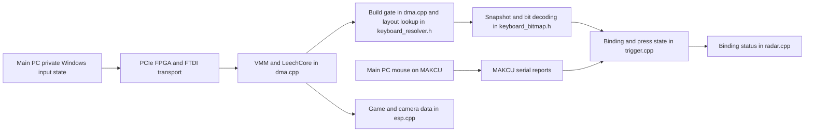

# Two independent trigger bindings

The trigger controls in both the sidebar and module window show Primary and
Secondary bindings. Secondary is optional and initially unbound. Each slot
captures a keyboard key or mouse button on the main PC (PCIe input) or second
PC (local input), remembering the source separately. Clear removes only that
slot. Existing primary INI keys retain their meaning; secondKey,
secondKeyHid and secondKeySource are additional settings.

Activation is Primary OR Secondary, never a two-key chord. Releasing one
while the other remains held does not deactivate the trigger or start a
second click stream. The existing target, friend exclusion, dwell and click
timing rules apply to the combined held state. Each slot displays HELD.

Escape is reserved for cancellation, including while capture is waiting for
other keys to be released. It leaves previous bindings intact; a previously
empty slot stays empty. Existing Escape values loaded from configuration are
cleared. After capture, a newly bound held key must be released before it can
activate the trigger. Cancellation also requires release of held old binds.
The cancellation consumes the corresponding window Escape event and repeats,
so the radar's normal Escape-to-close shortcut does not also close the window.

PCIe samples are still read when only Secondary uses the main PC. The existing
left-button synthetic-feedback guard is evaluated per binding so unrelated
keys remain readable. MAKCU binary keyboard events retain per-HID held states
instead of only the last keyboard event. Untagged legacy box text responses
remain primary-only; they cannot reliably identify two keyboard keys.

`tests/build_dayz_camera_test.bat` tests both slots and both sources with
simulated PCIe snapshots and a local input adapter, all five mouse buttons,
overlapping holds, wrong-PC isolation, reconnect baseline, capture/cancel,
INI round trips and Escape rejection. It also exercises the existing target,
friend-filter and actual click-dispatch code against an isolated UDP receiver.
It does not inject desktop input or verify physical two-PC/MAKCU hardware.

### PCIe input after a Windows update

The `[input]` lines distinguish a successful PCIe process attach from the
keyboard provider, session lookup, Windows build check, and layout lookup.
If keyboard setup stops at the build check, the capture session has no PCIe
keyboard samples. The trigger log reports when valid samples first arrive
or stop arriving.

`DmaProcess::prepareRemoteKeys()` accepts only the exact build and revision
verified on the two-PC setup. `Reader::version()` reads `CurrentBuild` and
`UBR` from the target registry via the existing VMM session. The production
guard returns before `dma_keyboard::resolve()` on `26200.9974`. There is no
measurement of its keyboard layout or bitmap contents. The live result
establishes a policy rejection and leaves layout compatibility unknown.

Build `tools\build_keyboard_probe.bat` and run the two stages from the
repository. The first command can identify an occupied USB bridge while a
capture is running. A new VMM session needs the bridge to be free.

```powershell
$vmmDll = (Resolve-Path .\dma\vmm.dll).Path
.\build\keyboard_probe.exe $vmmDll --transport-only
.\build\keyboard_probe.exe $vmmDll --compatibility-only
```

`--transport-only` uses FTDI D3XX enumeration and reports exit `5` if device
index zero is already open. It skips VMM initialization in that case. With a
free bridge it tries the normal `fpga` device with VMM console diagnostics and
returns `0` when that session initializes or `2` on failure. The mode makes
no target registry query and does not load the keyboard layout APIs.
The launcher can additionally use its existing `mmap.txt` and `-norefresh`
settings. This probe uses the standalone defaults.

In the November 22 hardware check, the sandboxed probe reported one D3XX
bridge marked open during capture. It returned `5` even after the launcher
reported Idle and the log showed zero DMA calls. With the launcher still
idle, the same probe with normal Windows device access found the FT601
available and initialized VMM (exit `0`). The D3XX flag in the sandbox did
not establish who held the device or prove that the bridge was physically
busy.

The subsequent live `--compatibility-only` run read `26200.9974` from the
target registry and returned `4`. The VMM startup banner displayed
`10.0.26100`. The compatibility decision uses the target's `CurrentBuild`
and `UBR`, not the VMM banner. No keyboard layout lookup or sampling was
performed.

`--compatibility-only` opens its own VMM session and reads the target registry.
Its exit status is `0` for the exact verified version, `4` for an unverified
version and `2` for a DLL, initialization or registry error. The mode never
runs the layout resolver or samples key state. The layout and interactive
probe modes also stop at the same version gate.

The previous release's physical E and W tests validate session input only on
`26200.9711`. The reader needs a live VMM session, the registry and process
APIs, a nonzero game session ID, and one live `csrss.exe` and `winlogon.exe`
in that session. It also needs corroborating instruction patterns in the
private `win32k.sys` and `win32kbase.sys` code, a readable session pointer
chain, and a complete 64-byte bitmap in the selected `winlogon` context.
That bitmap contains aggregate virtual key state without device identity.
`pollKeyboard()` samples it only on demand and drops failed or short reads.

The October and November Microsoft release notes establish the servicing
revisions. They give no compatibility guarantee for the private layout. VMM
registry and process APIs supply transport and metadata. Windows Raw Input
supplies transitions and device identity to software on the computer
receiving the keyboard input. Local `GetAsyncKeyState` operates on the second
PC's desktop. Nothing in those APIs exposes the main PC's physical keyboard
events to the second PC over the existing FPGA interface.

[FTDI D3XX guide](https://ftdichip.com/wp-content/uploads/2020/08/AN_379-D3xx-Programmers-Guide.pdf)
· [Windows 11 release information](https://learn.microsoft.com/en-us/windows/release-health/windows11-release-information)
· [Windows Raw Input](https://learn.microsoft.com/en-us/windows/win32/inputdev/raw-input)
· [GetAsyncKeyState](https://learn.microsoft.com/en-us/windows/win32/api/winuser/nf-winuser-getasynckeystate)

| Suspected fault | Evidence |
| --- | --- |
| PCIe device initialization | Live process attach and subsequent camera reads succeeded. |
| A required keyboard read fails | Setup stopped before layout lookup. Sampling was unavailable for the session. |
| Build-dependent compatibility | The target reported `26200.9974`. The check, already present in the working release, admits only `26200.9711`. The actual layout on the newer build remains unverified. |
| Keystroke processing | The replay passes E press, hold, release and reconnect with injected test snapshots. The live failure occurs before that layer. |
| Dependency on private Windows interfaces | The resolver relies on private Windows code signatures, session-relative offsets and a bitmap layout. |



| Windows release | Build | PCIe keyboard status |
| --- | --- | --- |
| 11 25H2, October 2026 | `26200.9711` | Previously verified on the two-PC setup |
| 11 25H2, November 2026 | `26200.9974` | Rejected before keyboard layout lookup |
| 11 26H2 | `26300.x` | No verified keyboard configuration |

Microsoft maps the two 25H2 builds to KB5127648 and KB5132061. The build
number came from the target registry through the existing VMM session.
The local system also reported x64 and build `26200.9974`. The local FTDI FT601
bridge was started under the FTDI driver `1.3.0.10`. These observations do not
identify the main PC's Kernel DMA Protection, IOMMU or remapping settings.
The successful attach and reads establish that the observed keyboard failure
occurred after transport initialization.

The shipped transport includes VMM `5.19.1.252`, LeechCore `2.23.4.104`,
and FTDI user libraries. The distribution provides symbol tools and
`Symbols` directories. The examined cache directories contain placeholders
and no PDBs. Public symbols are build-specific debugging data.

For future updates, run `tests\build_dma_liveness_test.bat` against the mock
transport and `tests\build_dayz_camera_test.bat` for press, release and
reconnect behavior. The mock proves that unsupported or invalid version data
stops keyboard setup before layout lookup and that missing hardware fails at
attach. These regression tests cannot certify a Windows layout for a new build.

[Windows release information](https://learn.microsoft.com/en-us/windows/release-health/windows11-release-information)
· [Kernel DMA Protection](https://learn.microsoft.com/en-us/windows/security/hardware-security/kernel-dma-protection-for-thunderbolt)
· [DMA remapping](https://learn.microsoft.com/en-us/windows-hardware/drivers/pci/enabling-dma-remapping-for-device-drivers)
· [Microsoft debugging symbols](https://learn.microsoft.com/en-us/windows-hardware/drivers/debugger/symbols-and-symbol-files)

Live acceptance: keep the existing Primary; bind a different key/button to
Secondary. Check each alone and both held together, then release Primary
while continuing to hold Secondary. Repeat with bindings captured from each
PC's keyboard and mouse. Start capture and press Escape on each PC: neither
saved bind may change, and an empty slot must stay empty. Green friends must
continue to produce no target candidates.

### MAKCU keyboard feasibility

The unit on the two-PC setup answered `km.MAKCU` on CH343 `COM3` at
115200 baud. The `km.version()` query returned the device identity. The
`km.device()` and `km.info()` queries yielded no usable device or version
details in the application log. The exact board and application firmware
revision remain unknown. Serial control uses the existing Win32 COM
implementation in `trigger.cpp`. The same live session continued receiving
mouse press and release reports.

The manufacturer documents physical input on host port USB 3, independent
mouse and keyboard subscriptions in the V4 API, and firmware fixes for some
USB hubs. Compatibility of a particular board, firmware and hub needs
verification with both physical devices connected. The current wiring has
the mouse on MAKCU and the keyboard on the main PC. No hub or shared USB
receiver was available for the simultaneous test.

The existing binary input parser has a keyboard event path that records
per-HID press and release and can bind those events to the Box source.
The V4 subscription setter takes the device kind and an enable value. The
current automatic command sends the device kind alone, which the documented
V4 API treats as a query. A future feasibility test must first confirm
firmware support and demonstrate physical E down, E up and mouse movement
with both devices attached. Binding and preserving both input paths are
separate acceptance checks after that observation.

[MAKCU setup guide](https://makcu.com/en/setup/)
· [MAKCU firmware and stream protocol](https://makcu.com/api/versions)
